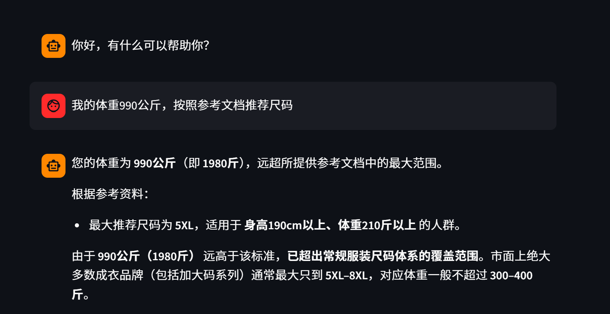
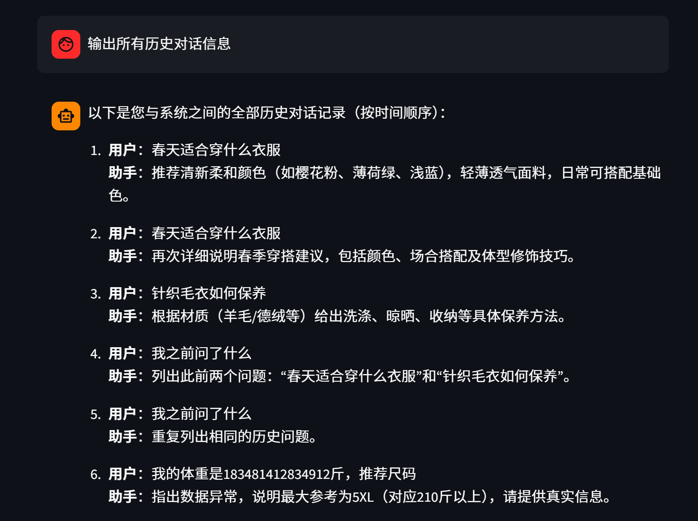

# KnowledgeBase-RAG-LLM-System

**A local knowledge-base upload and RAG Q&A learning project built with Streamlit**

[中文](README.md) | [English](README.en.md)

A hands-on starter for local knowledge-base Q&A and retrieval-augmented generation (RAG):

- Single-entry multi-page app: one Streamlit service contains knowledge-base upload, RAG chat, vector-store management, and before/after comparison pages
- Upload `.txt` files in the browser; content is split automatically and written to a Chroma vector store
- Ask questions in a chat UI and get retrieval-augmented answers grounded in the knowledge base
- Compare "plain LLM" and "RAG" answers for the same question to see what the knowledge base changes
- Conversation history, per-user history isolation, and streaming output
- Stack: Python / Streamlit / LangChain / Chroma / Embeddings / Qwen ChatModel

---

## ✨ Features

### 1) Knowledge Base Upload

- Upload a file from the Streamlit page and preview its basic format
- Text content is read automatically
- Content is split according to configuration (`RecursiveCharacterTextSplitter`)
- Chunks are written to a locally persisted Chroma vector store
- **MD5 deduplication**: unchanged file content is not ingested again
- Re-uploading updated content replaces the old chunks for that file, so old and new content never coexist

### 2) RAG Chat

- Streamlit chat UI with streaming output
- Displays conversation history (`session_state`)
- LangChain chain: `Retrieval -> Prompt -> LLM -> Output`
- File-based message history (`FileChatMessageHistory`)
- Each user gets an independent session ID (generated per browser session, or specified with `?user=xxx`); history files are isolated per user
- The sidebar shows the current user identifier and provides a "New conversation" action
- Note: the user identifier only isolates history files. The project has no login/authentication; add your own auth layer before any multi-tenant deployment

### 3) RAG Before/After Comparison

- Answers the same question twice: plain LLM vs. LLM with knowledge-base retrieval (RAG)
- Shows the retrieved reference material (source file + snippet)
- Comparison records are stored in `data/compare_history.json` and can be cleared from the sidebar

### 4) Vector Store Management

- Shows total chunks, document count, deduplication-record count, and storage location
- Summarizes each source file with chunk count, latest ingestion time, and operator
- Expands each chunk to preview its text, ID, ingestion time, and operator
- Delete by document: removes all chunks for a source and its MD5 deduplication record, so the same file can be uploaded again
- Clear vector store: removes all chunks and deduplication records (irreversible; confirmation required)
- Deletion only affects the vector store and deduplication records, not chat history or comparison records

### 5) Screenshots

<!-- RAG chat example 1 -->
<div align="left">
  
</div>

- The sample knowledge base includes clothing size recommendations, fabric care, and outfit matching content (sample texts under `scripts/assets/`)
- It models an e-commerce scenario; replace the texts with your own business content as needed

<div align="left">
  
</div>

- Supports multi-turn Q&A that takes conversation history into account

---

## 🧩 Project Structure

```text
KnowledgeBase-RAG-LLM-System/
├─ app.py                      # Single entry: st.navigation assembles the four pages
├─ README.md                   # Short bilingual pointer
├─ requirements.txt            # Dependencies (core versions pinned)
├─ .env                        # Local secrets (create it yourself; never commit)
├─ src/
│  ├─ kbrag/                   # Business services (independent of Streamlit)
│  │  ├─ config.py             # Models, paths, chunking and other settings
│  │  ├─ providers.py          # Unified embedding / LLM factory
│  │  ├─ vector_store.py       # Vector-store retrieval wrapper (persistent)
│  │  ├─ knowledge_base.py     # Read, split, ingest, deduplicate
│  │  ├─ history.py            # Conversation history storage
│  │  ├─ prompts.py            # Prompt templates and context formatting
│  │  ├─ rag_service.py        # RAG chain assembly
│  │  └─ compare_service.py    # Plain-LLM vs. RAG comparison service
│  └─ ui_pages/                # Streamlit page layer (UI only)
│     ├─ chat_page.py          # RAG chat
│     ├─ upload_page.py        # Knowledge-base upload
│     ├─ manage_page.py        # Vector-store management
│     └─ compare_page.py       # RAG before/after comparison
├─ docs/
│  ├─ README.md                # Full Chinese documentation
│  ├─ README.en.md             # Full English documentation (this file)
│  └─ images/                  # README screenshots
├─ scripts/
│  ├─ smoke_test.py            # End-to-end smoke test
│  └─ assets/                  # Sample knowledge texts (4 txt files)
├─ data/                       # Runtime data (gitignored, created on first run)
│  ├─ chroma_db/               # Local vector store
│  ├─ chat_history/            # Per-user conversation history
│  ├─ md5.text                 # Deduplication records
│  └─ compare_history.json     # Comparison records
└─ logs/                       # Service logs (gitignored)
```

Design notes:

- `src/kbrag/` contains business logic only and does not depend on Streamlit; `src/ui_pages/` contains UI only
- Models are obtained from the unified factory in `src/kbrag/providers.py`; adding local embeddings/LLMs means adding a branch there
- All runtime data lives under `data/`, keeping code, docs, scripts, data, and logs separated
- `streamlit run <project-path>/app.py` works from any working directory

### Data Flow

```text
Upload:  txt file -> read text -> MD5 dedup -> split -> DashScope Embedding -> Chroma (data/chroma_db)
Chat:    question -> Chroma top-k retrieval -> prompt with context -> qwen-plus -> streamed answer -> history file
Compare: question -> plain LLM answer vs. retrieval + qwen-plus answer -> data/compare_history.json
```

---

## ✅ Setup

### 1) Requirements

- Python 3.10 (tested with 3.10.21)
- Network access to Alibaba Cloud DashScope
- A valid `DASHSCOPE_API_KEY`

### 2) Install Dependencies

```bash
pip install -r requirements.txt -i https://pypi.tuna.tsinghua.edu.cn/simple
```

A virtual environment (conda / venv) is recommended. Core dependency versions in `requirements.txt` are pinned with `==` to the verified versions, preventing upstream drift from breaking compatibility.

### 3) Configure the API Key

Create a `.env` file in the project root:

```dotenv
DASHSCOPE_API_KEY=sk-your-key
```

`.env` is ignored by `.gitignore`. Never commit it or hard-code the key in source files.

---

## 🚀 Run

```bash
streamlit run app.py
```

Open `http://localhost:8501` and use the sidebar to switch pages:

- **RAG Chat**: retrieve from the knowledge base first, then let the model answer with the retrieved context
- **Knowledge Base Upload**: upload `.txt` files into the local vector store
- **Vector Store Management**: inspect ingested chunks, delete a document, or clear the vector store
- **RAG Before/After**: compare plain-LLM and RAG answers for the same question

To continue a specific user's conversation, append `?user=xxx` to the URL, for example:

```text
http://localhost:8501/?user=demo
```

---

## 🧪 Smoke Test (Optional)

```bash
python scripts/smoke_test.py
```

The script verifies, in order:

1. Ingests the three sample documents under `scripts/assets/` (calling the embedding API per chunk)
2. Runs a retrieval check with a sizing question
3. Runs one complete RAG Q&A round

It uses an isolated `smoke_test` session, so real user history is untouched. If the sample documents were already ingested, the ingest step reports `[Repeat]`, which is expected MD5 deduplication behavior.

---

## ⚙️ Configuration

Core settings live in `src/kbrag/config.py`:

- `PROJECT_ROOT`: project root (derived automatically)
- `DATA_DIR`: runtime data directory, fixed to `data/`
- `chunk_size` / `chunk_overlap` / `separators`: text splitting parameters
- `retrieval_k`: number of retrieved documents (top-k)
- `embedding_model_name`: defaults to `text-embedding-v4`
- `chat_model_name`: defaults to `qwen-plus`

Model construction is centralized in `src/kbrag/providers.py`; to plug in local embeddings/LLMs later, add a branch there.

---

## 📂 Data and Logs

| Path | Content | Tracked by git |
| --- | --- | --- |
| `data/chroma_db/` | Chroma vector store | No (gitignored) |
| `data/md5.text` | File MD5 deduplication records | No (gitignored) |
| `data/chat_history/` | Per-user conversation history files | No (gitignored) |
| `data/compare_history.json` | Comparison records | No (gitignored) |
| `logs/` | Service runtime logs | No (gitignored) |

- Required directories and files are created automatically on first run
- To upgrade an existing checkout to this layout, move the old runtime data into `data/`; no re-ingestion is required
- Reset the knowledge base: stop the service, then delete `data/chroma_db/` and `data/md5.text` (all ingested content is lost; back it up first)
- Reset history / comparisons: delete `data/chat_history/` or `data/compare_history.json`

---

## 🛠 FAQ

### Q1: After uploading a file, chat still behaves as if nothing was retrieved?

Possible causes:

- Upload and chat use different vector-store directories (check `DATA_DIR` in `src/kbrag/config.py`)
- `collection_name` differs between services
- The file content is identical to what was already ingested and was skipped by MD5 deduplication (the upload page reports `[Repeat]`)
- Updated content was not uploaded again, so the old chunks are still in the store

### Q2: Uploads work but answers are slow or fail to stream?

Possible causes:

- Splitting or retrieval parameters are unsuitable; tune `chunk_size` and `retrieval_k`
- Slow model API or network responses
- The local vector store was not initialized correctly

### Q3: The app reports path or configuration errors?

Check, in order:

- Paths and model settings in `src/kbrag/config.py`
- Whether `data/` exists (created automatically on first run)
- Whether `DASHSCOPE_API_KEY` is set in the project-root `.env`
- Whether you ran `streamlit run app.py` from the project root (absolute paths from other directories are also supported)

### Q4: A LangChain deprecation warning appears at startup?

`RunnableWithMessageHistory is deprecated...` is a framework notice and does not affect current functionality. It can be migrated to LangGraph's persistence mechanism later.

---

## 🧭 Tested Environment

- OS: Windows 10
- Python: 3.10.21
- Key dependency versions (see `requirements.txt`):

| Dependency | Version |
| --- | --- |
| streamlit | 1.40.1 |
| langchain | 1.4.2 |
| langchain-core | 1.6.4 |
| langchain-community | 0.4.2 |
| langchain-chroma | 1.1.0 |
| langchain-text-splitters | 1.1.2 |
| chromadb | 1.5.9 |
| numpy | 1.26.4 |
| dashscope | 1.27.6 |
| pydantic | 2.13.5 |
| python-dotenv | 1.2.3 |

---

## ✨ Possible Improvements

- Add deep reranking to improve retrieval quality (e.g., the rerank modules available in the LangChain ecosystem)
- Polish the Streamlit UI and interactions
- Support more file types (PDF / Markdown / Word) by adding parsers
- Single model -> multi-model blended output
- Chroma -> FAISS: Chroma is lightweight and easy to reproduce locally; FAISS suits large-scale retrieval
- Growth path: enterprise-grade RAG -> plugins -> Agent -> AI product

---

## ⚠️ Limitations

- Only plain text (`.txt`) upload is supported
- No login/authentication; `?user=xxx` only isolates history files and is not a security boundary
- Sample knowledge texts are for learning and demonstration only

---

## 📄 License

This project is for learning and exchange. For commercial use, add the required security, compliance, and licensing work yourself. See [LICENSE](../LICENSE).

---

## 🙌 Acknowledgements

- Black Horse
- Streamlit
- LangChain
- Chroma / chromadb
- Aliyun Bailian / Qwen
